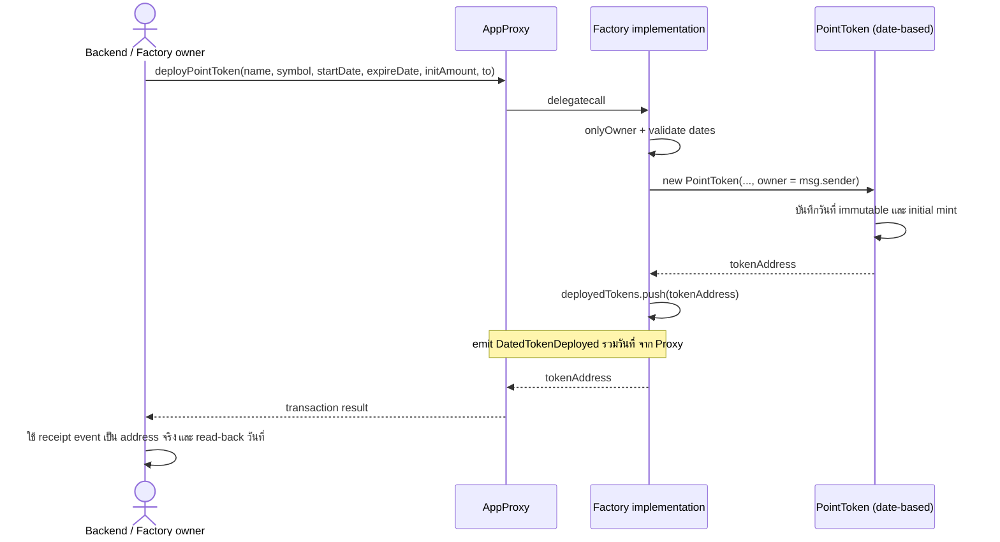
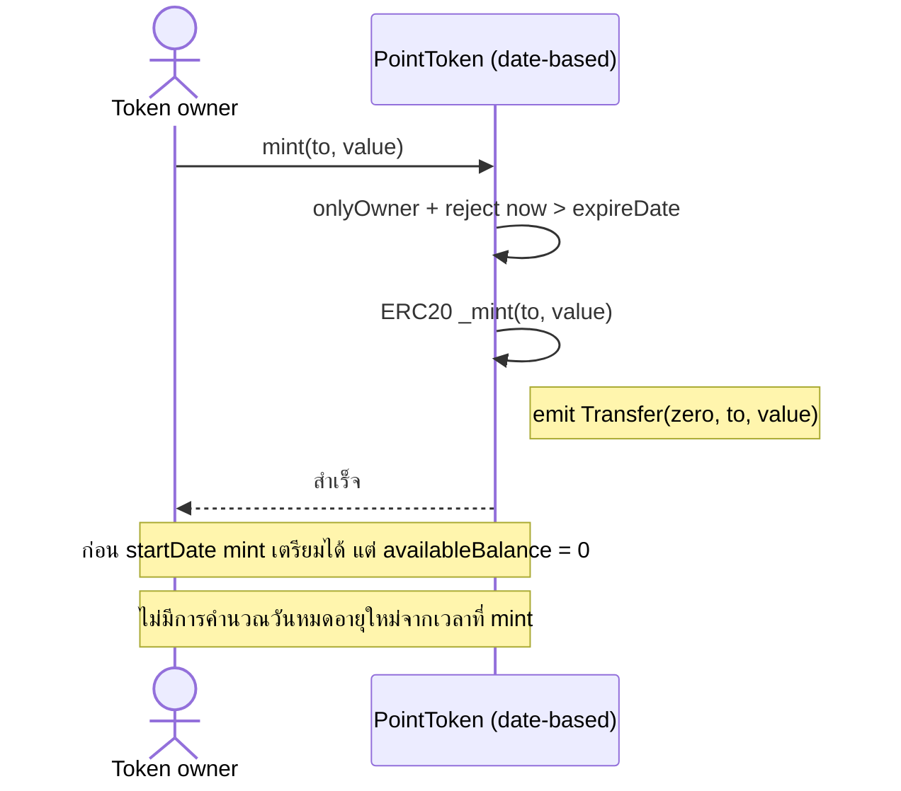

# Point Loyalty v3 validity and lifecycle

Updated 2026-10-09. The current contracts implement v3. Backend integration and external-chain rollout remain separate work.

## Current v3 contract

Identity creation is `deployPointToken(name, symbol)` on either factory. Both expose `pointTokenVersion() == 3`. The actual factory or proxy emits `TokenDeployed(tokenAddress, name, symbol, deployer)`. The caller owns the empty Draft token. Dates, business, recipient, and initial mint are not deployment inputs.

The owner configures the token exactly once. `configureBusiness` changes Draft to Configured and emits `BusinessConfigured`. There is no date setter or dated deployment overload.

| Business | Config bytes | Date rules | Transfer policy |
|---|---|---|---|
| A = 1 | `abi.encode(uint256 startDate, uint256 expireDate)` | Shared dates, `startDate <= now <= expireDate` | Standard ERC20 under the shared date guard |
| B = 2 | `abi.encode(uint8(0))` | Per-lot dates, inclusive expiry | FEFO_ONLY |
| C = 3 | `abi.encode(uint8(1))` | Per-lot dates, inclusive expiry | USER_SELECT |
| D = 4 | `abi.encode(uint8(policy))`, policy 0 or 1 | Delivery uses current Thai month start and a Thai month-start expiry 2 to 13 months ahead; expiry is exclusive | Selected policy |

A configuration and B/C dated issuance require ordered Unix seconds and expiry after execution time. Pending issuance is allowed for A/B/C. D configuration has no runtime dates. D delivery config is a 64-byte date pair, verified against Thai calendar boundaries for Owner and Marketer. The selected N is 1 to 12 months, with expiry at the following month start after those N months. See [D monthly delivery](POINT_D_MONTHLY_DELIVERY.md).

## Inventory and customer accounting

`mintInventory(account, value, issueId)` creates a Marketer inventory claim backed by ERC20 units at `address(token)`. It is owner-only and permitted even in Draft. It does not credit the Marketer's ERC20 customer balance.

`sendToCustomer(inventoryAccount, customer, value, deliveryConfig, deliveryId)` requires Configured state and consumes only the named inventory claim. It transfers escrow to the customer without changing supply. A uses empty delivery config. B/C/D use `abi.encode(uint256 startDate, uint256 expireDate)`. D additionally requires start at the current Thai month boundary and expiry 2 to 13 Thai months ahead. Equal date pairs share a lot. D Marketers must have permission and name their own inventory; only the Owner can deliver from another account's claim.

Direct A issuance is `mint(to, value, issueId)`. Direct B/C issuance is `mintLot(to, value, startDate, expireDate, issueId)`. D requires inventory delivery. `burn(from, value, redemptionId)` and `redeemFEFO` spend Active customer points; they never consume inventory or Pending balances.

| Query | Meaning |
|---|---|
| `balanceOf(account)` | Customer ERC20 ledger, including expired customer units; the token address holds escrow |
| `inventoryBalanceOf(account)` | Claim against escrow, not customer points |
| `totalSupply()` | ERC20 ledger supply including escrow |
| `availableBalanceOf(account)` | Active customer balance; Draft and escrow return zero |
| `availableSupply()` | A only, Active customer supply excluding escrow; other businesses reject |

Expiry needs no transaction and does not burn the ledger. Lot pruning removes expired or empty entries from the live index without erasing balances. Pending lots remain indexed. The current bound is 256 live wallet lots. A new distinct lot 257 rejects atomically, but existing live-lot credits remain allowed at capacity. Capacity does not guarantee that all 256 lots can transfer in one transaction: valid empty-recipient and mixed-recipient cases exceeded the local 30-million-gas budget. Smaller transfers and target-network estimation remain necessary.

## Transfers and operation IDs

B/C/D ordinary ERC20 transfers and `transferFrom` use FEFO. Recipients must opt into the actual sender with `allowSender`. Spender allowance does not replace sender consent. USER_SELECT operations require positive allocations strictly ascending by lot ID, not by expiry. Transfers preserve the original lot dates. D differs only at its exclusive expiry boundary.

Custom issuance and spending reject zero amounts; custom transfers reject self-transfer. Ordinary zero transfers remain allowed when validity and consent permit. Failed transactions roll back balances, allowance, inventory, lot creation, and operation records.

Operation IDs are scoped to the caller and bind the full selector and payload. Identical reuse reverts `AlreadyProcessed`. Changed reuse reverts `OperationConflict`. Backend authorization must precede privileged signer selection. Token ownership alone does not authenticate an end user.

## Current script flow and verification

The deployment helper takes only `{ name, symbol }`. Environment input generates a discriminated configuration, then separate configuration and optional inventory transactions:

| Env input | V3 behavior |
|---|---|
| No `POINT_BUSINESS` | Create and report Draft, with no manufactured dates or default issuance |
| `POINT_BUSINESS=A` | Require `POINT_START_DATE` and `POINT_EXPIRE_DATE` in seconds; check chain time before any transaction and again before configure |
| `POINT_BUSINESS=B` | Encode FEFO_ONLY = 0; reject conflicting `POINT_TRANSFER_POLICY` |
| `POINT_BUSINESS=C` | Encode USER_SELECT = 1; reject conflicting `POINT_TRANSFER_POLICY` |
| `POINT_BUSINESS=D` | Require FEFO_ONLY or USER_SELECT in `POINT_TRANSFER_POLICY`; no delivery dates yet |
| `POINT_INVENTORY_AMOUNT` | Explicit positive uint256 base-unit amount; requires nonzero `POINT_INVENTORY_RECIPIENT` and nonzero bytes32 `POINT_INVENTORY_OPERATION_ID` |
| `POINT_FACTORY_ADDRESS` | Required only for attaching scripts; version 3 and signer ownership must match |

The combined proxy runner initializes atomically. Attaching runners reject ownerless factories instead of initializing them. Deployment uses the mined `TokenDeployed` at the actual factory/proxy address. Configuration and stock issuance await successful receipts with the expected token emitter and matching payload. These stages are separate transactions; a later failure does not undo a successful identity deployment.

Tests cover identity-first state, authorization, configuration rollback, date boundaries, inventory accounting, consent, FEFO, operation IDs, and upgrade preservation. Run ordinary checks on the local simulated network:

```sh
./node_modules/.bin/hardhat test mocha --network hardhatMainnet
./node_modules/.bin/hardhat test solidity --network hardhatMainnet
./node_modules/.bin/hardhat run scripts/export_point_abis.ts
```

Canonical exports are `abi/PointToken.json`, `abi/PointTokenFactory.json`, and `abi/UpgradablePointFactory.json`. The factory registry and UUPS storage gap remain unchanged. An upgrade changes future creation, not code or balances at existing token addresses. V2 dated and legacy epoch selectors are absent from v3; old deployments and Ignition records retain their historical meaning.

## Historical v2 record, 2026-10-02

The remainder records the earlier shared-date-only v2 design and its validation at that time. Its constructor mint, dated deployment selector, version 2 event, test counts, and statements about unimplemented lot support are historical, not current v3 behavior. The current contract above supersedes them. Preserve this record for the earlier Coupon and Backend integration rationale.

วันที่รีวิว: 2026-10-02

สถานะ: Implemented ใน repository ฝั่ง Point: PointToken, Factory, interfaces, scripts และ tests ใช้วันตาม design แล้ว ยังไม่ได้ deploy บน external chain หรือแก้ Backend repository แยก

ข้อกำหนดเพิ่มเติมจากผู้ใช้: ค่ารับเข้าด้านวันของ Point รุ่นใหม่ต้องใช้ `startDate` / `expireDate` เหมือน Coupon โดยตรง ทั้งสองค่า required ไม่มี alias `endDate` และไม่มี input สำหรับคำนวณอายุแบบ months/epoch

## 1. ข้อเสนอหลัก

ให้ Point Token รุ่นใหม่มี `startDate` และ `expireDate` หนึ่งชุดต่อ token address ตามโมเดล `CouponType` ของ Coupon Marketplace Loyalty ทุกครั้งที่ mint ภายหลังใช้วันหมดอายุเดิม ไม่เริ่มอายุใหม่จากเวลาที่ mint

ใช้หนึ่งช่วงต่อ Point Token ตามที่ตกลงในบทสนทนา เพื่อให้ตรงกับ CouponType และ Point metadata

ตัวอย่าง: Point Token A เปิดใช้งาน 1 ตุลาคม และหมดอายุ 31 ธันวาคมตาม timestamp ที่กำหนด การ mint วันที่ 1 ตุลาคมหรือ 20 ธันวาคมหมดอายุ timestamp เดียวกัน โอนไม่ต่ออายุ หากต้องการรอบใหม่ ให้สร้าง token ใหม่

## 2. สิ่งที่พบจากโค้ดก่อน implementation

ตารางนี้บันทึกโค้ดรุ่นก่อนหน้า ปัจจุบันลบชุด PointToken/PointTokenFactory รุ่น block-based เดิมและ ERC7818 ที่เลิกใช้แล้ว ส่วน PointToken รุ่นวันที่ (เดิมชื่อ NewPointToken ก่อนเปลี่ยนชื่อ) มี implementation อยู่ใน `contracts/base/PointTokenBase.sol`.

| Source | พฤติกรรมปัจจุบัน / ผลต่อ design |
|---|---|
| `contracts/pointToken.sol:17` | ตั้งต้น window ด้วย block.timestamp ณ deploy และ secondsPerEpoch/windowSize โดย safe=false ไม่ได้รับ startDate/expireDate |
| `contracts/token/ERC7818/ERC7818.sol:122` | mint เก็บ epoch และ timestamp bucket ของแต่ละครั้ง |
| `contracts/token/ERC7818/ERC7818.sol:46` และ `:225` | แต้มแต่ละ bucket หมดอายุเมื่ออายุถึง duration × size |
| `contracts/token/ERC7818/ERC7818.sol:111` | isEpochExpired ตรวจระดับ epoch ซึ่งไม่ใช่คำตอบเดียวกับวันหมดอายุของแต่ละ bucket |
| `contracts/token/ERC7818/ERC7818.sol:509` | balanceOf คำนวณเฉพาะแต้มที่ยังไม่หมดอายุ |
| `contracts/token/ERC7818/ERC7818.sol:264` | API transferAtEpoch มี logic แยกจาก transfer ปกติ จึงไม่ควรแก้เพียง predicate จุดเดียวแล้วถือว่าทุก path เปลี่ยนแล้ว |
| `contracts/token/ERC7818/ERC7818.sol:500` | totalSupply คืน 0 เสมอ |
| `contracts/UpgradablePointFactory.sol:62` | Factory deploy token ด้วย new PointToken; token ไม่ใช่ proxy |
| `contracts/token/ERC7818/ERC7818B.sol` | มี epoch implementation อีกชุด แต่ไม่ถูกใช้โดย PointToken ปัจจุบัน |
| Coupon repo: `contracts/abstracts/BaseCoupon.sol:65` | CouponType มี startDate/expireDate แบบ uint256 และ validate startDate < expireDate |
| Coupon repo: `contracts/abstracts/BaseCoupon.sol:142` และ `:309` | ใช้งานได้เมื่อ startDate <= block.timestamp <= expireDate; expired เมื่อ now > expireDate |
| Coupon repo: `contracts/abstracts/BaseCoupon.sol:104` | mint ไม่ตรวจวันที่ และ ERC1155 balance ไม่หายเพราะหมดอายุ; ตรวจวันที่ที่ redemption |
| Backend repo: `src/providers/blockchain/blockchain.service.ts:252` | รับ startDate/endDate แต่ส่งเข้า Factory เป็น epochDuration และ ceil(remainingTime/epochDuration); startDate ไม่ถูกส่งเข้า contract |
| Backend repo: `src/modules/internal/point/handlers/createPoint.handler.ts:61` | DB เก็บ startDate/endDate/epochDuration ต่อ Point |
| Backend repo: `src/modules/internal/point/controllers/point.controller.ts:45` | update วันไปที่ DB โดยไม่มีการเปลี่ยนวัน on-chain |

ผลของ Backend conversion: อายุถูกปัดขึ้นเป็นจำนวน epoch เต็ม และเริ่มนับตาม mint timestamp แต่ละครั้ง จึงไม่ใช่วันหมดอายุแบบ absolute ที่ผู้ใช้ส่งมา ความล่าช้าก่อน transaction เข้า block เพิ่มความคลาดเคลื่อนของ initial mint ด้วย

ขอบเขตการอ่าน: source ใน working tree ของ point, coupon marketplace loyalty และส่วน point adapter ของ blockchain-backoffice-backend ไม่ได้ตรวจ state ของ deployment บน chain หรือยืนยัน address/ABI ที่ production ใช้อยู่

## 3. กติกาวันและสถานะ

ใช้ `uint256 startDate` / `uint256 expireDate` เป็น Unix timestamp หน่วยวินาที เพื่อให้ตรงกับ Coupon ABI รับ UTC timestamp; UI แสดง Asia/Bangkok และแปลง timezone ให้เสร็จก่อนส่ง วันอย่างเดียวต้องแปลงเป็นเวลาที่ระบุแน่นอน เช่น 31 ธันวาคม 23:59:59 Asia/Bangkok

ทั้งสองค่าต้องส่งมาอย่างชัดเจนจาก caller ไม่มีการเติม startDate เป็นเวลาปัจจุบันใน Backend และไม่มีการคำนวณ expireDate จากระยะเวลาใน create API

| สถานะ | เงื่อนไข |
|---|---|
| Pending | now < startDate |
| Active | startDate <= now && now <= expireDate |
| Expired | now > expireDate |

- validate `startDate < expireDate` และ `expireDate > block.timestamp` ตอนสร้างใหม่
- ยอมรับ startDate ในอดีตเพื่อเปิดใช้งานทันที แต่ไม่สร้าง token ที่หมดอายุแล้วผ่าน flow ปกติ
- ณ expireDate วินาทีเดียวกันยังใช้ได้ ตาม Coupon; expireDate + 1 ใช้ไม่ได้
- `isExpired()` ตรวจ now > expireDate โดยตรง ไม่ใช้ !isActive() เพราะ Pending ยังไม่หมดอายุ
- เก็บวันที่แบบ immutable ไม่มี setter ในรุ่นแรก ป้องกันการเปลี่ยนอายุของยอดที่แจกไปแล้วหรือการฟื้นยอดหมดอายุ
- วันเดียวกันทั้ง token ไม่ต้องใช้ epoch, sliding window, timestamp buckets หรือ FIFO ในรุ่นใหม่

ข้อเสนอ mint ต่างจาก Coupon ปัจจุบันหนึ่งจุดโดยตั้งใจ: ยอมให้ mint ล่วงหน้าก่อน startDate เพื่อเตรียมแจก แต่ไม่ยอม mint หลัง expireDate ป้องกันแจกแต้มที่ใช้ไม่ได้

## 4. ยอดคงเหลือและการใช้แต้ม

แนะนำใช้ ERC20 ledger ตามปกติ แล้วแยกยอดที่ใช้ได้ออกจากยอดที่ถืออยู่ เหมือน Coupon ที่ balance ยังอยู่หลังหมดอายุ:

| API / operation | Pending | Active | Expired |
|---|---|---|---|
| balanceOf(account) | ยอดที่ถืออยู่ | ยอดที่ถืออยู่ | ยอดที่ถืออยู่ |
| availableBalanceOf(account) | 0 | balanceOf(account) | 0 |
| totalSupply() | supply ใน ledger | supply ใน ledger | supply ใน ledger |
| availableSupply() | 0 | totalSupply() | 0 |
| mint(to, value), onlyOwner | อนุญาต | อนุญาต | PointExpired |
| transfer / transferFrom | PointNotStarted | อนุญาต | PointExpired |
| approve / allowance | อนุญาต | อนุญาต | อนุญาต แต่ใช้โอนไม่ได้ |
| burn(from, value), onlyOwner | PointNotStarted | อนุญาต | PointExpired |

การ burn ในตารางเป็นการใช้/หักแต้มตาม flow เดิม จึงต้องอยู่ในช่วง Active หากต้องการล้างยอดหมดอายุเพื่อบัญชี ให้เสนอ admin cleanup แยกต่างหากภายหลัง ไม่เปิด burn หลังหมดอายุโดยไม่แยกความหมาย

ข้อเปลี่ยนแปลงที่ต้อง review: balanceOf เดิมหมายถึงยอดใช้ได้ แต่รุ่นใหม่หมายถึง ledger balance; Backend/UI ต้องเรียก availableBalanceOf สำหรับช่องยอดที่ใช้ได้และ precheck การใช้แต้ม totalSupply เดิมคืน 0 แต่รุ่นใหม่เป็น supply จริง ใช้ version dispatch ไม่ใช้ ABI เดียวตีความทั้งสองรุ่น

เวลาผ่าน expireDate ไม่สร้าง transaction หรือ Transfer event อัตโนมัติ ยอด ledger ไม่ถูก burn อัตโนมัติ Indexer เก็บยอดจาก canonical events และคำนวณ available จากวันที่ ณ เวลาที่อ่าน ไม่รอ event หมดอายุ การตัดสินธุรกรรมจริงใช้ block.timestamp ของ block ที่ execute เสมอ

ทางเลือกเพื่อรักษา balanceOf เดิม: ให้ balanceOf/totalSupply แสดงยอดที่ใช้ได้ และเพิ่ม storedBalanceOf/storedSupply สำหรับ audit แต่จะทำให้ยอดเปลี่ยนตามเวลาโดยไม่มี Transfer event จึงต้องเพิ่ม logic ให้ indexer และ consumers มากกว่า แนวทางหลักแนะนำ ledger balance + availableBalance แยกกัน

## 5. Contract / API ที่เสนอ

ใช้ชื่อ `PointToken` สำหรับ implementation รุ่นวันที่ที่ deploy ใหม่ ใช้ OpenZeppelin ERC20 + Ownable ที่ repository ใช้อยู่ ตรวจช่วงเวลาใน transfer path กลางและใน public mint/burn ให้ transfer และ transferFrom ใช้กติกาเดียวกัน รวม zero-value และ self-transfer ไม่จำเป็นต้อง rename contract; token address ที่ deploy ด้วย code เดิมยังใช้ epoch เช่นเดิม

API รุ่นใหม่ที่เสนอ:

- `startDate()` / `expireDate()` / `getPointDates()`
- `isActive()` / `isExpired()` / `validityStatus()`
- `availableBalanceOf(account)` / `availableSupply()`
- `mint(to, value)` และ `burn(from, value)` onlyOwner
- ERC20 name/symbol/decimals/totalSupply/balanceOf/approve/allowance/transfer/transferFrom

คง decimals = 18 และ owner = ผู้เรียก Factory ตาม code เดิม `to` เป็นผู้รับ initial mint ไม่ใช่ token owner; Backend field ownerAddress ปัจจุบันใช้เป็น recipient จึงต้องตรวจว่า signer ของ mint/burn ตรงกับ owner จริง การเปลี่ยนโมเดลเจ้าของเป็นคนละ decision

ใช้ชื่อ `deployPointToken(name, symbol, startDate, expireDate, initAmount, to)` โดย parameter วันที่เป็น uint256 ทั้งคู่ ชื่อ method เดิมแต่ ABI selector เปลี่ยนจากรุ่น uint40/uint8 Implementation นี้ไม่รองรับ legacy deployment selector; rollout ให้ deploy Factory รุ่นวันที่ที่ address ใหม่และ route ตาม version (`pointTokenVersion() == 2`) Token addresses เดิมไม่เปลี่ยน logic หากจะ upgrade Factory เดิม ต้อง coordinate consumers เพราะ deployment selector เดิมจะใช้ไม่ได้

ค่ารับเข้าด้านวันที่ให้ตรงกับ `createCouponType(string name, uint256 startDate, uint256 expireDate)`:

| Field | Required | Contract type | API representation |
|---|---|---|---|
| startDate | ใช่ | uint256 | Unix timestamp วินาที เป็นจำนวนเต็ม |
| expireDate | ใช่ | uint256 | Unix timestamp วินาที เป็นจำนวนเต็ม |

ชื่อ field ต้องเป็น `startDate` / `expireDate` เหมือนกันตลอด DTO → service → Factory → Token → event → response/DB projection ไม่มี `endDate`, `expiryMonths`, `epochDuration`, `secondsPerEpoch` หรือ `windowSize` ใน request รุ่นใหม่ ถ้าส่ง field เก่าให้ตอบ validation error แทนการ ignore หรือแปลงโดยเงียบ ๆ

Point ยังรับ name/symbol และ initial mint parameters เพราะสร้าง ERC20 contract ส่วน Coupon สร้าง type ภายใน ERC1155; การทำให้ค่ารับวันเหมือนกันไม่เปลี่ยน Point เป็น CouponType หรือเพิ่ม redeem code

Validation ของ DTO ใช้ required + integer + range ที่ API รองรับอย่างชัดเจน ตรวจ null/missing/fraction/negative/unsafe integer และ millisecond timestamp ที่อยู่นอก supported date range; ไม่แปลง Unix milliseconds เป็น seconds อัตโนมัติ สัญญา ABI ยังใช้ uint256 ตาม Coupon ส่วน API ที่รับ JSON number ต้องจำกัดให้เป็น safe integer ก่อนแปลง BigInt

- Factory onlyOwner เช่นเดิม; validate ทั้งที่ Factory และ Token constructor
- เพิ่ม token address ลง deployedTokens เดิม; ไม่เปลี่ยนตำแหน่ง storage ของ Factory
- เพิ่ม event แยก `DatedTokenDeployed(tokenAddress, name, symbol, deployer, initAmount, to, startDate, expireDate)` ให้ adapter/indexer ระบุรุ่นและวันที่ได้จาก receipt
- ไม่เปลี่ยน schema event TokenDeployed เดิม; ไม่ emit สอง deployment events สำหรับ token เดียวโดยไม่มีนโยบาย deduplication
- รุ่นใหม่ไม่ implement IERC7818 และไม่มี API epoch เพื่อไม่สร้าง semantics epoch จำลอง
- ข้อเสนอเดิมเก็บ PointToken รุ่น block-based และ NewPointToken (ชื่อเดิมของ PointToken รุ่น time-based ปัจจุบัน) ไว้ใน legacy path ปัจจุบันลบชุด legacy ออกจาก source แล้ว โดย deployment เดิมบน chain ไม่เปลี่ยนแปลง

## 6. Sequence ที่เสนอ

Sequence ฉบับล่าสุดตามบทสนทนา รวม Create, Mint, Transfer และ Burn พร้อม error paths อยู่ใน [POINT_DATE_VALIDITY_SEQUENCES.md](POINT_DATE_VALIDITY_SEQUENCES.md) ชื่อ DatePointToken/deployDatedPointToken ใน draft เดิมปรับเป็น PointToken/deployPointToken โดยยังเป็น ABI และ deployment รุ่นใหม่

### Create



### Mint



### Transfer

```mermaid
sequenceDiagram
    actor U as Holder / Spender
    participant T as PointToken (date-based)
    U->>T: transfer หรือ transferFrom
    T->>T: ตรวจ Active; ตรวจ allowance ถ้า transferFrom
    T->>T: ERC20 balance / address checks
    T->>T: หักยอดผู้ส่ง เพิ่มยอดผู้รับ
    Note right of T: emit Transfer(from, to, value)
    T-->>U: true
    Note over U,T: ไม่มี FIFO; ทุกยอดอยู่ใต้ startDate/expireDate เดียวกัน
    Note over U,T: ล้มเหลวแล้ว revert ทั้งยอดและ allowance
```

Diagram แสดง successful path ของ implementation; tests ครอบคลุม InvalidDateRange, PointNotStarted, PointExpired, unauthorized, invalid address, insufficient balance/allowance และ constructor revert ไม่เพิ่ม deployedTokens

## 7. Backend และ integration plan

1. เพิ่ม contractVersion / validityMode เพื่อเลือก legacy epoch หรือ absolute dates ตาม token address และ approved Factory deployment event
2. Create DTO/type ใช้ startDate และ expireDate แบบ required เหมือน Coupon; API รุ่นใหม่ไม่รับ endDate alias, expiryMonths หรือพารามิเตอร์ epoch หาก consumer เก่าจำเป็นต้องใช้งาน ให้ route เข้ารุ่น legacy ที่ระบุชัดเจน ไม่ปะปนใน dated request
3. UI ให้ผู้ใช้กำหนดช่วง startDate/expireDate และส่ง timestamp วินาทีตรง ๆ; create flow รุ่นใหม่ไม่เรียก calculateExpiryTimestamp หรือ calculateFromExpiryMonths
4. เลิก calculateEpochDuration/windowSize สำหรับรุ่นใหม่; epochDuration ใน DB รองรับ legacy และค่อย deprecate ไม่ลบทันที
5. ตรวจ Unix seconds เป็นจำนวนเต็ม ไม่รับ millisecond timestamp โดยเงียบ ๆ ค่า amount ยังเป็น raw integer/BigInt ไม่เปลี่ยน precision ในงานนี้
6. ไม่ส่ง startDate หรือ expireDate ให้ validation error ไม่เติมค่า default; freeze timestamps จาก request เดิมเมื่อ retry และให้ contract ตรวจเทียบ block.timestamp ตอน execute
7. เปลี่ยน ABI/DTO/errors ของ create; เก็บ address จาก event ใน mined receipt แทนถือว่า staticCall address preview เป็นผลจริง
8. อ่านวันที่จาก token/receipt แล้วบันทึก DB ด้วยชื่อ startDate/expireDate; migrate field endDate เดิมและเก็บ epochDuration ไว้สำหรับ legacy โดยกำหนด version mapping ชัดเจน response รุ่นใหม่ไม่ส่งชื่อ endDate; date metadata ต้องแก้ตรง DB อย่างเดียวไม่ได้ ถ้าเลือก immutable ให้ update endpoint ปฏิเสธการเปลี่ยนวันและแก้ได้เฉพาะ branding metadata
9. Backend getBalance/precheck/UI แสดง ledgerBalance, availableBalance และสถานะ; แยก pending/expired
10. Projector เก็บวันและ version จาก event/ABI ที่ verify ได้ แล้วคำนวณ availability ตาม chain timestamp พร้อม asOfBlock/asOfTime; handle reorg/replay ตามระบบเดิม ไม่จำลอง burn event เมื่อเวลาผ่าน

Coupon Marketplace integration ที่อ่านพบ: BaseMarketplace รองรับ IERC20 payment แต่ BaseMarketplaceUpgradeable._validateListing ปัจจุบันรับเฉพาะ THB เท่านั้น การทำให้ point เป็น payment token ในรุ่น Upgradeable ต้องเป็นงาน integration แยก ไม่เกิดขึ้นเพียงเปลี่ยนวันหมดอายุของ point การคืนเงินหลัง point หมดอายุเป็นอีก policy เพราะ transfer ที่หมดอายุถูกปฏิเสธ ไม่รับรอง refund ของ non-THB ในงานนี้

## 8. Deployment / ยอดเก่า

Factory เป็น UUPS แต่ token ที่ deploy เป็น contract ปกติ การ upgrade Factory เปลี่ยนได้เฉพาะสิ่งที่สร้างใหม่ ไม่เปลี่ยน logic หรือยอดของ token address เดิม

แนะนำ phase แรก: รองรับ legacy token และ dated token คู่กัน เริ่มสร้างใหม่ด้วย dated flow ยอดเก่าอยู่ใต้เงื่อนไขเดิมจนหมดอายุ ไม่เปลี่ยน UI date ของยอดเก่าให้เหมือนเปลี่ยน contract แล้ว

หากต้องย้ายยอดเก่า ต้องมีแผน migration แยก: สำรวจ addresses/versions และบัญชียอด ณ canonical block; หยุดหรือ lock/burn การใช้ยอดเก่าผ่านกลไกที่มีสิทธิ์ทำจริง; กำหนด cutoff และอายุยอดใหม่; ป้องกัน double credit/double spend ก่อน mint ยอดใหม่ ต้องยืนยันว่าหยุด transfer ของ token เก่าได้จริง เพราะ legacy token ไม่มี pause ใน code นี้ Snapshot และ airdrop อย่างเดียวไม่พอ

Factory implementation รักษา owner, deployedTokens และ __gap เดิม แต่เปลี่ยน deployment ABI; ใช้ Factory address ใหม่สำหรับ rollout และ map version ใน adapter การ upgrade วันที่ไป V2 ทดสอบ preservation ของ owner, registry และ token dates แล้ว ไม่ได้อ้างว่ารองรับ legacy deployment method หลัง upgrade epoch Factory

## 9. สถานะ implementation และงานต่อเนื่อง

| Phase | Deliverable / gate |
|---|---|
| 1. ตกลง semantics — เสร็จ | หนึ่งช่วงต่อ token; balanceOf เป็น ledger; availableBalanceOf เป็นยอดใช้ได้; mint ล่วงหน้า; วัน immutable และ expiry boundary ตามเอกสาร |
| 2. Contract รุ่นวันที่ — เสร็จ | PointToken + date interface + tests; token addresses เดิมไม่เปลี่ยน logic |
| 3. Factory — เสร็จ | PointTokenFactory และ UpgradablePointFactory ใช้ date ABI, DatedTokenDeployed และ version 2; ทดสอบ UUPS owner/registry preservation; ไม่รองรับ epoch deployment selector เดิม |
| 4. Adapter — ทำบางส่วน | Export ABI และปรับ scripts ใน repo นี้แล้ว; Backend DTO/create/balance/update, DB version fields และ indexer ยังเป็นงานต่อเนื่องใน repository แยก |
| 5. Local validation — ผ่าน | Compile, Hardhat Solidity/Mocha tests, fuzz, TypeScript typecheck และ simulated local deployment ผ่าน |
| 6. Rollout — ยังไม่ทำ | ใช้ Factory address ใหม่; dry run chain เป้าหมายและตรวจ ABI/version/events/วันที่ก่อน deploy จริง |

ผล validation หลัง review/refactor: Hardhat test ผ่าน Solidity 17 tests และ Mocha 51 tests รวม 68 tests; Solidity fuzz 2 tests รันอย่างละ 256 cases; tsc --noEmit ผ่าน และ deploy_proxy_and_token.ts ผ่านบน simulated local chain ไม่มี transaction บน external chain Host ใช้ Node v25.0.0 ซึ่ง Hardhat แจ้ง unsupported runtime; README แนะนำ Node 22 สำหรับ environment ใช้งานจริง Solidity tests และ fuzz รันผ่าน Hardhat ได้โดยไม่ต้องมี forge ใน PATH

ผล review และการแก้ไข:

- Scripts เดิมมี error paths ที่ log แล้ว return ทำให้ process รายงานสำเร็จ: เปลี่ยนเป็น throw และ error handler กลางที่ตั้ง exit code 1 พร้อมปิด network connection ใน finally
- Script ที่ attach Factory เคยลอง initialize เมื่อ owner เป็นศูนย์: เปลี่ยนเป็น reject และให้การสร้าง proxy initialize แบบ atomic เท่านั้น
- การอ่าน deployment event เดิมตรวจเฉพาะชื่อ event: รวม receipt parser ให้ตรวจ status และ emitter ตรง Factory/proxy ที่เรียก ก่อนยอมรับ token address
- Script deploy proxy/token เคยตรวจวันหมดอายุหลังส่ง implementation/proxy transactions ไปแล้ว: เพิ่ม preflight เทียบ latest chain timestamp ก่อนส่ง transaction และตรวจซ้ำก่อนสร้าง token; contract ยังตรวจตอน execute เพื่อรองรับเวลาที่ผ่านระหว่าง mining
- รวม input parsing, preflight และ deploy/receipt workflow ที่ซ้ำกัน; ตัด ts-ignore ใน scripts กลุ่มนี้ และตรวจ zero address/checksum ของ Factory input
- ลดเงื่อนไข expiry ที่ซ้ำใน PointToken._update โดยคง mint-before-start และ inclusive expiry เดิม; ไม่เปลี่ยน ABI, inheritance หรือ storage declarations ของ Factory ในรอบ refactor

Regression tests สำหรับ scripts ครอบคลุม date input ที่ผิดรูปแบบ/หน่วย, missing dates, invalid Factory address, version/owner, expiry เท่ากับ chain timestamp, receipt ล้มเหลว/ไม่มี event/emitter ผิด และ deployment receipt จริงของ Factory ทั้งสองแบบ

## 10. Test / acceptance criteria

- วันที่เท่ากันหรือ start > expire ต้อง revert; past start + future expiry สร้างได้; expired creation และ recipient zero ที่ initial mint > 0 ต้อง revert
- Request รุ่นใหม่ต้องมี startDate/expireDate ทั้งคู่; missing/null/fraction/negative/unsafe integer/millisecond ที่นอก supported range ต้อง validation error และห้าม fallback เป็น now
- Request รุ่นใหม่ที่ส่ง endDate, expiryMonths, epochDuration, secondsPerEpoch หรือ windowSize ต้อง validation error; ทดสอบชื่อและค่าของ startDate/expireDate ตรงกันใน request, event, read-back, DB และ response
- ตรวจ startDate - 1, startDate, expireDate - 1, expireDate, expireDate + 1 ด้วย block timestamp ที่กำหนดตรง ๆ
- mint ก่อนเริ่มได้ ยอด ledger เพิ่ม แต่ available = 0; mint ก่อนวันหมดอายุหลายช่วงเวลา ทุกยอดหมดอายุพร้อมกัน
- transfer/transferFrom/burn ใช้ได้เฉพาะ Active; insufficient allowance/balance และ failure ไม่เหลือ partial state
- โอนหลายทอดและ self-transfer ไม่เปลี่ยนวันที่หรือ supply; zero-value เป็นไปตาม time gate เดียวกัน
- ledger balance และ supply ไม่หายเมื่อเวลาเปลี่ยน; available เป็น 0 นอกช่วงเวลา; sum ledger balances = totalSupply
- approve/revoke ได้โดยไม่ฟื้นแต้มหมดอายุ; unauthorized mint/burn/deploy ถูกปฏิเสธ
- event/ABI/DB วันที่ตรงกัน; stale backend precheck ไม่ช่วยให้ transaction หลัง expiry สำเร็จ
- Factory รุ่นวันที่ upgrade คง owner/deployedTokens และวันที่ของ token; ABI รุ่นใหม่ไม่มี legacy epoch deployment selector และ adapter ต้องแยกรุ่นของ token เก่า
- Indexer replay และอ่าน balance หลังหมดอายุให้ผลเหมือน direct on-chain read โดยไม่ต้องมี expiry event
- ตรวจ token-version dispatch, receipt address, update API ปฏิเสธ date mismatch และ frontend timezone conversion

## 11. ถ้าต้องการวันแยกแต่ละล็อต

ต้องเปลี่ยน design หลักเป็น lot-based token: `PointLot(lotId, startDate, expireDate)` และ `balance[account][lotId]`; mint ต้องระบุ lotId; transfer เก็บ identity และวันที่เดิมของแต่ละ lot; consume แต้มที่ active และหมดอายุเร็วสุด (FEFO) แทนลำดับ mint (FIFO)

ERC20 aggregate ต้องเลือกและกระจาย lots อย่าง deterministic พร้อม events ที่บอก lot attribution, APIs อ่านยอด/transferAtLot, bounded traversal/pagination และ gas limits เพื่อไม่วนล็อตไม่จำกัด อาจใช้ ERC1155 ต่อ lot หากยอมเปลี่ยน consumer/payment interfaces โมเดลนี้รองรับหลายวันใน token เดียว แต่ไม่ใช่การเพิ่มสอง fields ให้ token เฉย ๆ

Implementation นี้ใช้หนึ่งช่วงต่อ token ตามที่ตกลงไว้ การเปลี่ยนเป็นหลายล็อตต้องออกแบบใหม่และมีแผน migration แยก
