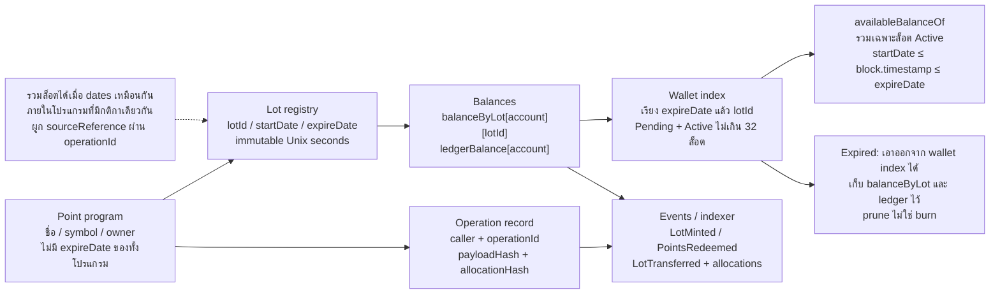
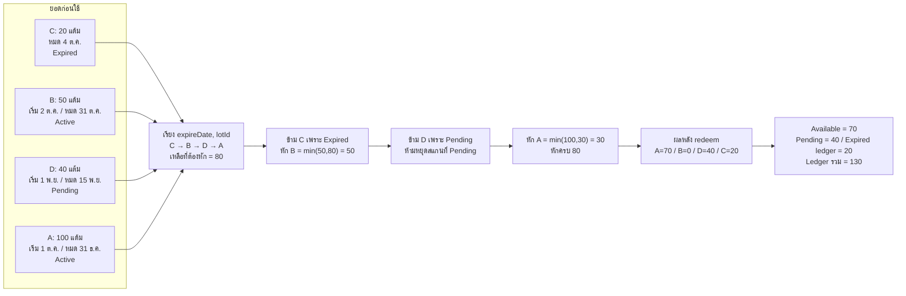

# Point lot design record and v3 status

อัปเดต 9 ตุลาคม 2026. Contract และ ABI รุ่น v3 implement แล้วใน repository และผ่าน local tests แต่ยังไม่ได้ deploy ขึ้น external chain หรือ implement Backend.

Flow ปัจจุบันสร้าง `deployPointToken(name, symbol)` เป็น Draft ก่อน แล้ว Token owner ตั้ง `configureBusiness(business, config)` ครั้งเดียว. Inventory เก็บเป็น claim ของแต่ละ Marketer โดยมี ERC20 escrow ของ token เป็นหลักประกัน. การแจกใช้ `sendToCustomer(inventoryAccount, customer, value, deliveryConfig, deliveryId)` เพื่อระบุแหล่ง inventory โดยตรง และไม่ mint supply ซ้ำ.

B/C ใช้วันล็อตแบบ inclusive; D ใช้ต้นเดือนไทยที่แจกและ expiry ที่ต้นเดือนไทยถัดไป 2 ถึง 13 เดือนแบบ exclusive ตาม [กติกา D รายเดือน](POINT_D_MONTHLY_DELIVERY.md) เลือก N ต่อการส่งได้ 1 ถึง 12 และคู่วันที่เดียวกันรวมเป็นล็อตเดียว Standard `transfer` และ `transferFrom` ของ B/C/D ผ่าน FEFO และ recipient opt-in เช่นเดียวกับ custom transfer Manual allocations เรียง `lotId` จากน้อยไปมาก Wallet index จำกัด 256 ล็อต ส่วน D มีขอบเขต 90 live lots ตามกติกาเดือน การรองรับจำนวนล็อตไม่รับประกัน gas budget ต้อง estimate บน network เป้าหมายและแบ่งจำนวนเมื่อจำเป็น Refund, reversal และ reward settlement ยังเป็นงานแยก

API และ sequence ปัจจุบันอยู่ใน [README](../README.md#point-loyalty-v3-lifecycle-and-abi) และ [Point Loyalty v3 sequences](POINT_DATE_VALIDITY_SEQUENCES.md). Miro วันที่ 8 ตุลาคมเป็นแบบร่างก่อนเพิ่ม argument `inventoryAccount`; รอบ implementation นี้ไม่ได้แก้บอร์ด.

## Historical proposal, 5–6 October 2026

เนื้อหาด้านล่างเป็นข้อเสนอเดิมก่อน implementation ไม่ใช่ specification ของ ABI ปัจจุบัน. ชื่อ `deployPointProgram`, ledger ที่แยก supply เอง และ API/event ในแบบร่างต้องเทียบกับ v3 ข้างต้นก่อนนำไปใช้.

วันที่ 5 ตุลาคม 2026. สถานะ: ข้อเสนอเพื่อ review เท่านั้น ยังไม่ได้ implement หรือ deploy.

เพิ่มเติม 6 ตุลาคม 2026. มีทางเลือก manual lot transfer ตาม journey C. วันหมดอายุยังอยู่ระดับล็อตเหมือนเดิม. ค่า default ที่เสนอคือ FEFO_ONLY; โปรแกรม USER_SELECT อนุญาตทั้ง transferFEFO และ transferLots. การ redeem ยังคง FEFO. [Journey ทั้งสามรูปแบบ](POINT_VALIDITY_JOURNEYS.md)

[Miro FEFO design](https://miro.com/app/board/uXjVEf-WvPA=/?moveToWidget=3458764685993392384)

## Recommended scope

- Custom on-chain lot ledger: contract เป็นผู้เลือก FEFO เพื่อไม่ต้องเชื่อรายการล็อตที่ Backend ส่งมา
- หนึ่ง contract ต่อโปรแกรมที่มี spending policy เดียวกัน; startDate/expireDate ย้ายจาก token constructor ไปเป็น immutable metadata ของ lot
- ล็อตเรียงตาม (expireDate, lotId) จากน้อยไปมาก; lotId เพิ่มต่อเนื่องและคงที่
- ช่วง Active ยังคง inclusive ตาม design ปัจจุบัน: startDate <= block.timestamp <= expireDate
- Pending และ Expired ข้ามไปได้ แต่ห้ามหยุด scan ที่ Pending เพราะล็อตถัดไปอาจ Active
- ยอดไม่พอหรือรับล็อตไม่ได้ต้อง revert ทั้ง transaction ไม่ใช้ partial success
- Owner mint และ redeem ตามสิทธิ์เดิม; ผู้ใช้โอนของตนเองผ่าน transferFEFO หรือ transferLots เมื่อ policy อนุญาต; recipient opt-in เพื่อป้องกันการส่ง dust จน slot เต็ม
- เป็น API รุ่นใหม่ ยังไม่อ้างว่า drop-in compatible กับ ERC20 transferFrom/allowance; marketplace integration ต้อง review ก่อนเลือกลงโค้ด

## Roles and journeys

Journey แยก Marketer และ End user สำหรับแต่ละ A/B/C อยู่ใน [POINT_VALIDITY_JOURNEYS.md](POINT_VALIDITY_JOURNEYS.md). Marketer เป็นบทบาทธุรกิจที่สร้างโปรแกรมและออกแต้มผ่าน Admin service. การ deploy ต้องใช้สิทธิ์ Factory owner; mint/mintLot และ burn/redeemFEFO ใช้สิทธิ์ Token/program owner. สิทธิ์ในหน้า Admin ไม่ทำให้บัญชีนั้นเป็น owner บน chain โดยอัตโนมัติ.

| บทบาท | การกระทำในโปรแกรมล็อต B/C | ผู้ส่ง transaction หรือผู้ตรวจ |
|---|---|---|
| Marketer | เลือก FEFO_ONLY หรือ USER_SELECT ตอนสร้างโปรแกรม | Factory owner ผ่าน Admin service ตามข้อเสนอ v3 |
| Marketer | กำหนดวันที่ล็อตและออกแต้มให้สมาชิก | Program owner เรียก mintLot |
| End user | รับแต้มและอ่านยอด Active/Pending/Expired | App อ่านข้อมูลจาก chain และประวัติ |
| End user | โอนอัตโนมัติ หรือเลือกล็อตเมื่อ policy อนุญาต | Wallet ผู้ส่งเรียก transferFEFO/transferLots |
| End user ผู้รับ | อนุญาตให้ผู้ส่งโอนเข้าตาม opt-in ที่เสนอ | Wallet ผู้รับเรียก allowSender |
| End user | ขอใช้แต้มแลกรางวัล | Redemption service ตรวจสมาชิก, บัญชีและ order |
| Marketer/service | ดำเนินการตัดแต้มและจัดส่งรางวัลตามคำขอ | Program owner เรียก redeemFEFO, รอ receipt และ reconcile fulfillment |

การสร้าง program กับการออกแต้มเป็นคนละขั้น. B/C สร้างโปรแกรมแล้ว mint หลายล็อตภายใน address เดิม ไม่สร้างเหรียญใหม่ทุกครั้งที่สมาชิกได้รับแต้ม. End user เริ่มคำขอ redeem แต่ไม่เรียก onlyOwner method โดยตรง. การคืนแต้มและ reversal ยังคงเป็นข้อเสนอส่วนถัดไป ไม่ได้เพิ่ม API จากการแยกบทบาทนี้.

## Storage and bounded work

Lot registry ใช้ lotId และ dates immutable. ภายในโปรแกรมที่ policy เดียวกันสามารถ reuse lotId เมื่อคู่ startDate/expireDate ตรงกันทุกค่า; ห้าม round dates โดยเงียบ ๆ. Source order/reference เก็บใน Backend และผูกกับ operationId ที่อยู่ใน event.

เก็บ balanceByLot[account][lotId], cached ledgerBalance[account], ledgerSupply และ walletLotIds[account] ที่เรียง FEFO. เสนอ maximum 32 entries ต่อ wallet เป็นค่าตั้งต้นที่ต้อง benchmark ทั้ง worst-case insertion และ transfer ก่อน implement ไม่ใช่การรับรอง gas limit.

ทุก credit path ต้อง prune zero/expired entries ใน index ก่อนตรวจ capacity และ merge ยอดใน lotId ที่มีอยู่. ห้ามลบ Pending ออกจาก index เพียงเพราะยังใช้ไม่ได้. Expired entries เอาออกจาก index ได้เพราะ dates immutable แต่ balanceByLot และ ledgerBalance ต้องยังคงอยู่. Prune ไม่ใช่ burn และไม่ลด supply. ประวัติ/รายการล็อตหมดอายุอ่านผ่าน pagination หรือ indexer.

availableBalanceOf วนเฉพาะ bounded wallet index และรวมยอด Active. ไม่เสนอ global availableSupply ที่วนทุกผู้ใช้บน chain; ถ้าต้องใช้รายงานรวมให้คำนวณจาก indexer พร้อม asOfBlock/asOfTime.

_selectFEFO อ่านไม่เกิน 32 entries สร้าง allocation ใน memory ด้วย take=min(balance, remaining). ตรวจว่าหักครบก่อนเขียน state. Transfer ตรวจจำนวน unique recipient lot IDs หลัง prune และหลังรับ allocations ทั้งชุดก่อนเขียนยอด. ถ้า receiver เต็มต้อง reject ไม่เลือกลล็อตอายุยาวกว่ามาแทน FEFO.

## Operations and retry

API proposal:

- Factory v3 deployPointProgram(name, symbol, transferSelectionPolicy) สร้างโปรแกรมว่าง ไม่มี dates ระดับโปรแกรม; เสนอ policy immutable เป็น FEFO_ONLY หรือ USER_SELECT
- mintLot(to, value, startDate, expireDate, operationId): onlyOwner; value > 0; nonzero recipient; startDate < expireDate; expireDate > block.timestamp
- redeemFEFO(from, value, operationId): onlyOwner; value > 0; ตัดเฉพาะ Active
- transferFEFO(to, value, operationId): from=msg.sender; value > 0; nonzero recipient; เสนอ reject self-transfer ใน custom API นี้
- transferLots(to, allocations, operationId): เฉพาะโปรแกรม USER_SELECT; from=msg.sender; allocations เป็นรายการ lotId/value ที่ผู้ส่งเลือกเอง; ยังเป็น API proposal ไม่ได้เพิ่มใน ABI ปัจจุบัน
- allowSender(sender, allowed): ผู้รับเป็นผู้กำหนดสิทธิ์การรับจาก sender; owner mint เป็น trusted issuance แยกจาก public transfer

Contract เก็บ operation record ตาม caller + operationId และ payloadHash ซึ่งต้องรวม action selector และพารามิเตอร์ทั้งหมด. ใช้ ID เดิม payload เดิมให้ AlreadyProcessed; ID เดิม payload ต่างให้ OperationConflict. Backend ผูก order/reference กับ stable operationId และ confirmed receipt เพื่อคืนผลเดิม ไม่สร้าง transaction ใหม่ด้วย ID ใหม่เมื่อ retry. เมื่อ owner/signer เปลี่ยน ต้องคง business dedup ระดับ service เพราะ namespace caller เปลี่ยนได้.

ทุก operation ต้อง validate authorization ก่อนใช้ operation record. การหัก/เพิ่ม balances, supply, allocations และ mark processed ต้องอยู่ใน transaction เดียว. Events มี caller/operationId และข้อมูล lot allocations เพียงพอสำหรับ reconciliation. Receipt ยืนยันผ่าน RPC; ใน sequence ลูกศร contract→service ที่ระบุ receipt เป็นการย่อขั้นตอนรอ receipt จาก chain.

## Manual lot transfer alternative

ข้อมูล transferLots คือ recipient, allocations และ operationId. แต่ละ allocation มี lotId กับ value ใน token base units. รายการต้อง nonempty, จำกัดขนาดตาม resource bound ที่จะวัดจริง, lotId ไม่ซ้ำและเรียงจากน้อยไปมาก, ทุก value > 0. Contract คำนวณ total จากผลรวม allocations ไม่เชื่อ total ที่ UI แสดง. ลำดับ payload ตาม lotId เป็นการทำให้คำขอเหมือนเดิมเมื่อ retry ไม่ใช่การบังคับเลือกล็อตหมดอายุก่อน.

UI อ่าน policy และรายการล็อตแบบ pagination พร้อม asOfBlock/asOfTime. ผู้ใช้เลือกได้เฉพาะ Active lots และระบุจำนวนในแต่ละล็อต. UI ส่ง payload ที่เรียงแล้วและให้ยืนยันผู้รับ, allocations, total และ dates. Read API สำหรับ policy/ล็อตยังต้องออกแบบในรุ่นใหม่; ไม่มี method นี้ใน ABI v2.

Contract ตรวจ policy, authorization, recipient ไม่เป็น zero/self และ opt-in ก่อนหักยอด. ตรวจทุก lotId ว่ามีจริง, Active เมื่อ execute และ balanceByLot[msg.sender][lotId] >= value. ตรวจ recipient capacity ของทั้ง allocations หลัง prune ก่อนเขียน state. ถ้าล็อตใดหมดอายุ, ยัง Pending, ยอดไม่พอ หรือผู้รับรับไม่ได้ ต้อง revert ทั้ง transaction โดยไม่ fallback ไปล็อตอื่นหรือทำ partial transfer.

หักผู้ส่งและเพิ่มผู้รับใน lotId/dates เดิม, ปรับ ledgerBalance ทั้งคู่, supply คงเดิม, prune zero entries และ mark operation ใน transaction เดียว. Payload hash รวม action selector, recipient และ canonical allocations ทั้งชุด. Caller อยู่ใน namespace ของ operation record. ID เดิม payload เดิมให้ AlreadyProcessed; ID เดิม payload ต่างให้ OperationConflict เช่นเดียวกับ API อื่น. เปลี่ยนล็อตหรือจำนวนให้เป็นคำขอใหม่หลังตรวจผลคำขอเดิมแล้ว ไม่ใช้ retry เปลี่ยน payload โดยเงียบ ๆ.

transferLots อนุญาตให้ส่งล็อตอายุยาวกว่าโดยเก็บล็อตใกล้หมดไว้ จึงไม่บังคับ FEFO สำหรับ transfer ในโปรแกรม USER_SELECT. โปรแกรม FEFO_ONLY ต้องปฏิเสธ method นี้บน chain ไม่ใช่ซ่อนปุ่มใน UI อย่างเดียว. redeemFEFO ยังเลือกล็อตอัตโนมัติตามกฎเดิม. การเปลี่ยน signature ของ Factory v3 ข้างต้นเป็นการปรับข้อเสนอเท่านั้น ไม่เปลี่ยน Factory, Token หรือ ABI ที่ deploy แล้ว.

## Refund and settlement decisions

ข้อเสนอ refund: อ้าง original redemption allocations; คืนไปยังผู้ถูกหักเดิมและ lotId/dates เดิม; expired lot เพิ่มได้เฉพาะ ledger ไม่ทำให้ใช้ได้อีก. ถ้า product ต้องการ grace period ให้เป็น explicit compensation operation ไม่ใช่เปลี่ยน dates เดิม.

หากเก็บ original allocation เป็น hash ต้องส่งรายการ allocation ทั้งชุดมาตรวจ hash (ไม่เกิน 32) และตรวจ original account, original operation, action type, cumulative refunded amount ต่อ allocation พร้อม operationId ใหม่ของ refund. ห้ามใช้ข้อมูลจาก indexer โดยไม่ตรวจเทียบหลักฐาน on-chain. การคืนล็อตที่ยัง Active ต้องผ่าน receiver capacity check ด้วย; ถ้าเต็มต้องมีกระบวนการ retry/จัดการกรณีนี้ก่อนเปิดใช้งาน refund จริง.

MVP แสดงเฉพาะ atomic point debit. ไม่อ้างว่า database order หรือ reward ภายนอก atomic ไปพร้อม chain. Checkout ต้องมี reconciliation และ compensation เมื่อหักแต้มสำเร็จแต่ส่ง reward ไม่สำเร็จ. Reservation และการย้อน earned/pending points ยังเป็น design phase ถัดไป ไม่ใช้ redeemFEFO แทน admin reversal ทุกกรณี.

## Validation and rollout

ต้องทดสอบ: equal expiry tie-break, out-of-order mint, Pending ก่อน Active, exact start/expire boundary, expiry+1, insufficient balance rollback, duplicate/conflicting operation ID, receiver cap, dust/opt-in, transfer preserving dates, zero/self transfer policy, mint/transfer/redeem conservation, prune preserving expired ledger, refunds capped to original allocations, indexer reorg/replay.

Manual transfer ต้องทดสอบเพิ่ม: FEFO_ONLY ปฏิเสธ transferLots แม้เรียกตรง, USER_SELECT ส่งล็อตอายุยาวกว่าที่เลือกได้, ล็อตไม่มีจริง, duplicates/noncanonical/empty/oversized allocations, จำนวนศูนย์, ยอดล็อตที่เลือกไม่พอแม้ล็อตอื่นพอ, selected lot หมดอายุหลัง preview, rollback ทั้ง batch เมื่อหนึ่งล็อตไม่ผ่าน, preserve dates/supply และ retry/conflict ของ canonical allocations. ไม่กำหนด 32 เป็นเพดานยืนยันจากการเพิ่ม journey นี้.

Deploy token/ledger ใหม่สำหรับ v3. Factory upgrade เปลี่ยนเฉพาะการสร้างใหม่ ไม่เปลี่ยน token address เดิม. ย้ายยอดเก่าต้องมี migration ป้องกัน double spend แยกต่างหาก. เปลี่ยน Backend DTO/ABI/UI และ marketplace adapter พร้อม version dispatch. ตัวเลข cap 32, recipient opt-in, refund-after-expiry และ custom API เป็นข้อเสนอที่ต้องทบทวนก่อน implementation.

## Board diagrams

### FEFO · 01 Data model

[เปิดใน Miro](https://miro.com/app/board/uXjVEf-WvPA=/?moveToWidget=3458764685993392384)

Proposed v3 · วันที่อยู่ระดับล็อต · หนึ่ง contract ต่อโปรแกรมแต้ม



### FEFO · 02 Worked example

[เปิดใน Miro](https://miro.com/app/board/uXjVEf-WvPA=/?moveToWidget=3458764685993392385)

ณ 5 ต.ค. 2026 · ใช้ 80 แต้ม · ต้องใช้ล็อต B ก่อน A แม้ B ได้มาทีหลัง



### FEFO · 03 Mint sequence

[เปิดใน Miro](https://miro.com/app/board/uXjVEf-WvPA=/?moveToWidget=3458764685993392386)

mintLot(to, value, startDate, expireDate, operationId) · onlyOwner ตามสิทธิ์เดิม

```mermaid
sequenceDiagram
autonumber
actor O as Program owner
participant S as Backend / Script
participant P as Proposed Point contract
participant X as Indexer
O->>S: to, value, startDate, expireDate, operationId
S->>S: ตรวจ Unix seconds และ sourceReference
S->>P: mintLot(...)
P->>P: onlyOwner และ checkOperation(caller, operationId, payloadHash)
break operationId เดิม
P-->>S: AlreadyProcessed หรือ OperationConflict
end
P->>P: to != 0; value > 0; startDate < expireDate
P->>P: expireDate > block.timestamp ตอนออกแต้ม
P->>P: หา lotId จาก dates หรือสร้าง immutable lot ใหม่
P->>P: prune expired / zero entries จาก wallet index
Note right of P: prune ไม่ลบ expired ledger balance
break ล็อตใหม่ทำให้ wallet index เกิน 32
P-->>S: revert TooManyLots
end
P->>P: เพิ่ม balanceByLot[to][lotId] และ ledgerBalance[to]
P->>P: insert lotId ตาม expireDate, lotId ถ้ายังไม่มี
P->>P: เพิ่ม ledger supply; บันทึก operation
Note right of P: emit LotMinted พร้อม lotId, value, dates, operationId
P-->>S: receipt
S->>S: ยืนยัน status และ emitter; ผูก operation กับ sourceReference
X->>X: อ่าน event จาก chain และสร้างประวัติการได้รับ
Note over S,P: ทุก validation failure revert ทั้ง transaction
```

### FEFO · 04 Redeem sequence

[เปิดใน Miro](https://miro.com/app/board/uXjVEf-WvPA=/?moveToWidget=3458764685993392387)

redeemFEFO(from, value, operationId) · contract เลือกล็อตเอง · all-or-nothing

```mermaid
sequenceDiagram
autonumber
actor U as Member
participant S as Redemption service
participant P as Proposed Point contract
U->>S: ขอใช้แต้มกับ order
S->>S: ตรวจสิทธิ์ผู้ใช้ / order / stable operationId
S->>P: availableBalanceOf(from) เพื่อ preview
P-->>S: ยอด ณ block ที่อ่าน
S->>P: redeemFEFO(from, value, operationId) โดย owner
P->>P: onlyOwner; from != 0; value > 0; checkOperation
P->>P: อ่าน wallet index ทั้งชุด ไม่เกิน 32 entries
loop เรียง expireDate ASC, lotId ASC จน value ครบ
P->>P: ข้ามยอดศูนย์ / Pending / Expired โดยใช้ block.timestamp
P->>P: take = min(lotBalance, remainingToSpend)
P->>P: เก็บ allocation ใน memory; ลด remainingToSpend
end
break remainingToSpend > 0
P-->>S: revert InsufficientAvailablePoints
S-->>U: ไม่หักแต้มแม้แต่ล็อตเดียว
end
P->>P: หัก balanceByLot ตาม allocations และลด ledgerBalance / supply
P->>P: เอาล็อตยอดศูนย์ออกจาก index; mark operation processed
Note right of P: emit PointsRedeemed และ allocation ต่อ lotId
P-->>S: mined receipt
S->>S: ยืนยัน receipt ก่อนยืนยันการตัดแต้มกับ order
S-->>U: ใช้แต้มสำเร็จ พร้อมยอดคงเหลือ
Note over S,P: Retry ใช้ operationId เดิม; service คืนผลเดิมเมื่อ AlreadyProcessed
Note over S,P: Quote อาจเก่า; การเลือกล็อตจริงและตรวจยอดทำบน chain
```

### FEFO · 05 Transfer sequence

[เปิดใน Miro](https://miro.com/app/board/uXjVEf-WvPA=/?moveToWidget=3458764685993392388)

transferFEFO(to, value, operationId) · เจ้าของแต้มโอนเอง · ผู้รับได้ล็อตและวันเดิม

```mermaid
sequenceDiagram
autonumber
actor A as Sender
participant P as Proposed Point contract
actor B as Recipient
B->>P: allowSender(A, true)
Note over B,P: Proposed opt-in ป้องกันรับ dust จนจำนวนล็อตเต็ม
A->>P: transferFEFO(B, value, operationId)
P->>P: from = msg.sender; checkOperation
P->>P: value > 0; B != 0; B != from; recipient อนุญาต sender
P->>P: _selectFEFO(from, value, block.timestamp)
Note right of P: ใช้ selector เดียวกับ redeem; ข้าม Pending / Expired
break ยอด Active ไม่พอ
P-->>A: revert InsufficientAvailablePoints
end
P->>P: prune expired / zero entries ใน recipient index
P->>P: คำนวณจำนวน lotId ใหม่ทั้งหมดก่อนเขียน balance
break จำนวนล็อตผู้รับหลังโอนเกิน 32
P-->>A: revert TooManyLots โดยไม่หักยอดผู้ส่ง
end
loop แต่ละ lot allocation ไม่เกิน 32
P->>P: หัก sender และเพิ่ม recipient ใน lotId เดิม
P->>P: insert recipient lotId ตาม expireDate, lotId ถ้ายังไม่มี
end
P->>P: ปรับ ledgerBalance ทั้งคู่; supply คงเดิม
P->>P: prune sender zero entries; mark operation processed
Note right of P: emit LotTransferred พร้อม lotId / value / operationId
P-->>A: mined receipt
Note over A,B: วันเดิมไม่ถูก reset และไม่เปลี่ยนเป็นล็อตอายุยาวกว่า
```
